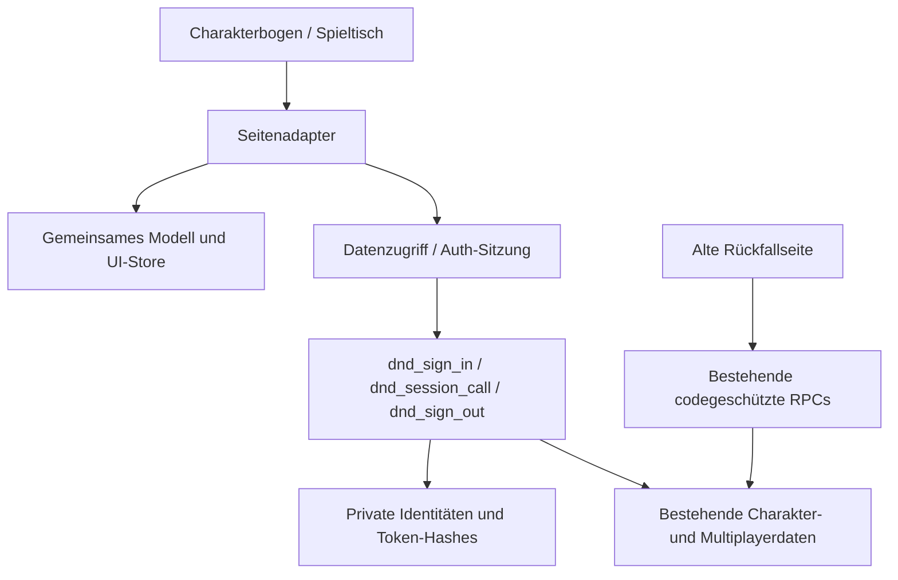

# Architektur nach Phase 1

Die statische Anwendung benötigt keinen Build-Server zur Laufzeit.
GitHub Pages liefert HTML, src und public; Supabase bleibt das einzige Backend.

Ein neues Feature erweitert Domänenmodell, autorisierte RPC-Operation und
Seitenkomponente gemeinsam. Keine Tabellen direkt aus einer UI-Komponente lesen.
Die DOM-Darstellung ist keine Berechtigungsgrenze. Der UI-Store ist nur ein
View-State; Token bleiben in der geschlossenen Auth-Schicht. Serverantworten
bestimmen die Identität bei jeder Wiederherstellung.

Charakterfelder und Ressourcen bleiben rückwärtskompatible JSONB-Bögen.
Die Legacy-Ansichten verwenden weiterhin ein einziges normalisiertes Objekt pro
Charakter. Ein schrittweiser Ersatz einzelner Renderer ist möglich, ohne die
Datenbank oder die ganze Anwendung umzuschreiben.

Entscheidungen und Grenzen: [Phase-1-Bericht](PHASE-1.md).

Phase 2 ergänzt `src/ui/player-dashboard.js` (Ansichten desselben Charakters),
`src/ui/gm-workspace.js` (GM-Arbeitsumgebung) und einen tokengebundenen
Workspace-RPC. Vorbereitung und Recaps liegen privat in eigenen Tabellen;
Veröffentlichungen sind ein ausdrücklicher separater Schreibvorgang.
[Details und Abnahme](PHASE-2.md).

Phase 3: `src/data/live.js` empfängt tokenautorisierte SSE-Zustellungen aus der
Supabase Edge Function `dnd-events`. `sync_events` und Cursor sind pro Empfänger
privat; SQL filtert vor der Übertragung. `dnd_sync_call` kapselt Charakter-CAS und
idempotente Würfe. Kein clientseitiges Realtime-Rollenattribut/JWT. Details und
bewusste Kompatibilitätsgrenzen stehen in PHASE-3.md.

Phase 4: `src/ui/combat.js` verbindet den gemeinsamen Kampfmanager mit
`dnd_combat_call`. PC-Zustände verbleiben im Charakter-JSON, NPC-Zustände in der
einheitlichen Kampf-/späteren Tokeninstanz. Private/öffentliche Projektionen und
Versionen entstehen serverseitig; Details und Regelgrenzen in PHASE-4.md.

Phase 5: `src/ui/vtt.js` verwendet `dnd_vtt_call` für private Bildkacheln,
Kartenfreigabe und versionierte Tokenpositionen. Keine vollständige Karten-URL
an Spieler; serverseitige Kachel-/Objektprojektion. `vtt_tokens.combatant_id`
verweist eindeutig auf die gemeinsame Kampfinstanz, ohne deren TP zu kopieren.
Geometrie liegt separat in `src/core/vtt.js`. Grenzen und Abnahme: PHASE-5.md.

## Kampagnenbuch (Phase 6)

`src/ui/campaign.js` nutzt ausschließlich `campaign.*` am bestehenden Client.
`dnd_campaign_call` prüft GM-Identität, CAS und unveränderliche Command-Receipts;
Spieler erhalten nur explizite Veröffentlichungssnapshots der serverseitig
gebundenen aktuellen Kampagne. Story-Kanten benötigen sichtbare Endpunkte.
`campaign_sessions` bindet Sitzungen unveränderlich, `campaign_resources` verknüpft
bestehende Pläne, Karten und Encounters. Additive Trigger schützen auch Aufrufe
bestehender Clients gegen kampagnenübergreifende Aktivierung/Veröffentlichung.
Der Builder ruft den bestehenden Kampf-RPC transaktional auf; HP bleiben im
Charakterbogen beziehungsweise in `combatants`, Kartentoken referenzieren dieselbe
Instanz. `src/core/campaign.js` liefert die ausdrücklich beratende DMG-2014-Schätzung.
