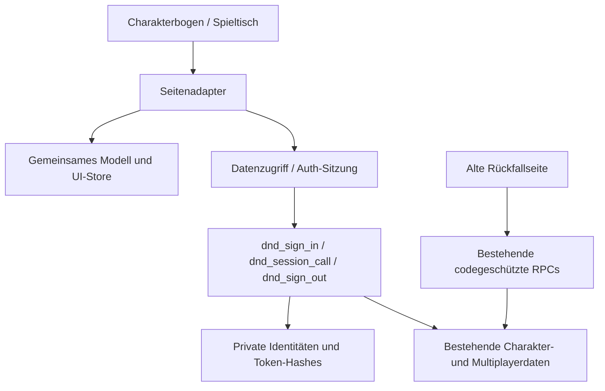

# Architektur nach Phase 1

Die statische Anwendung benötigt keinen Build-Server zur Laufzeit.
GitHub Pages liefert HTML, src und public; Supabase bleibt das einzige Backend.

Ein neues Feature erweitert Domänenmodell, autorisierte RPC-Operation und
Seitenkomponente gemeinsam. Keine Tabellen direkt aus einer UI-Komponente lesen.
Die DOM-Darstellung ist keine Berechtigungsgrenze. Der UI-Store ist nur ein
View-State; Token bleiben in der geschlossenen Auth-Schicht. Serverantworten
bestimmen die Identität bei jeder Wiederherstellung.

Charakterfelder und Ressourcen bleiben rückwärtskompatible JSONB-Bögen.
Die Legacy-Ansichten verwenden weiterhin ein einziges normalisiertes Objekt pro
Charakter. Ein schrittweiser Ersatz einzelner Renderer ist möglich, ohne die
Datenbank oder die ganze Anwendung umzuschreiben.

Entscheidungen und Grenzen: [Phase-1-Bericht](PHASE-1.md).
